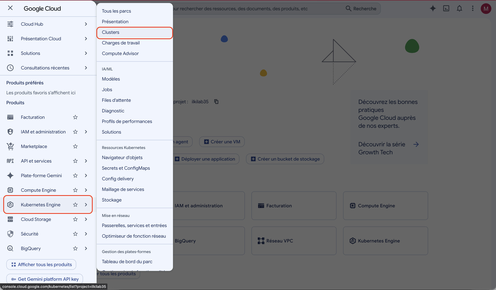
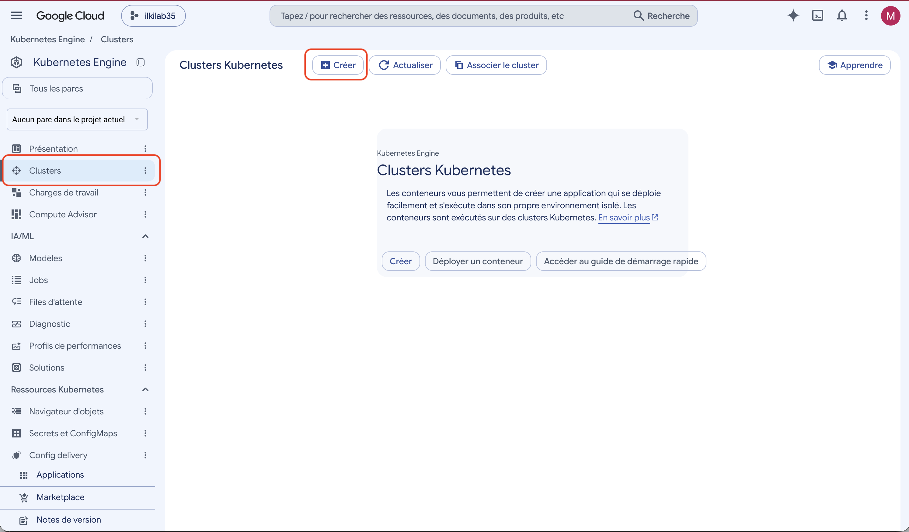
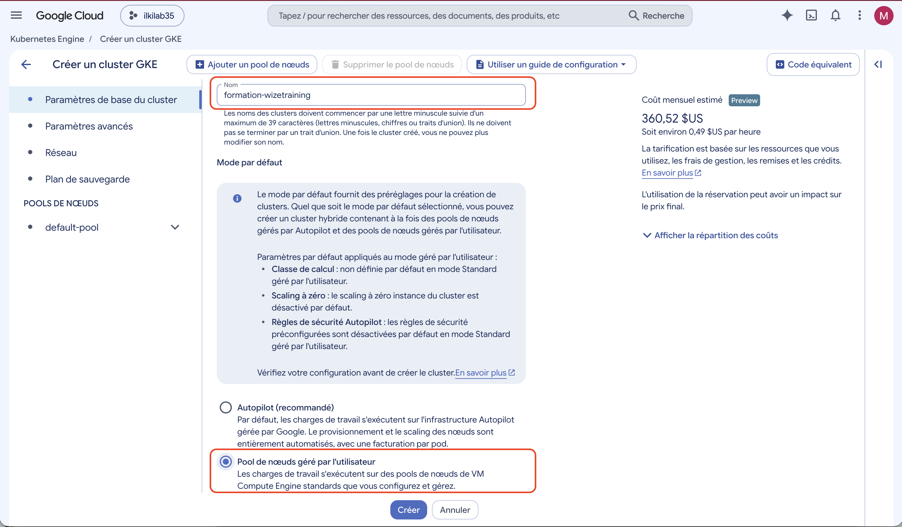
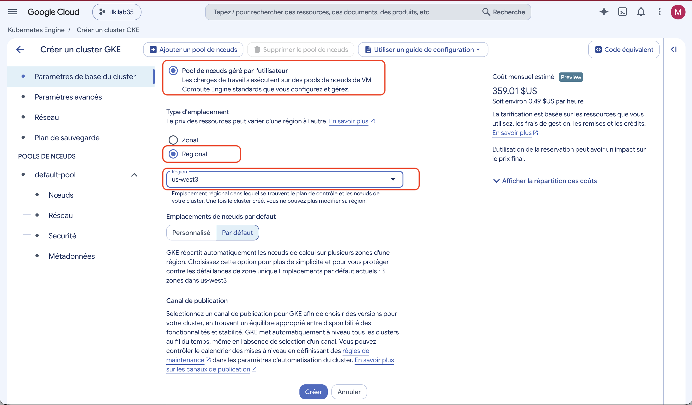
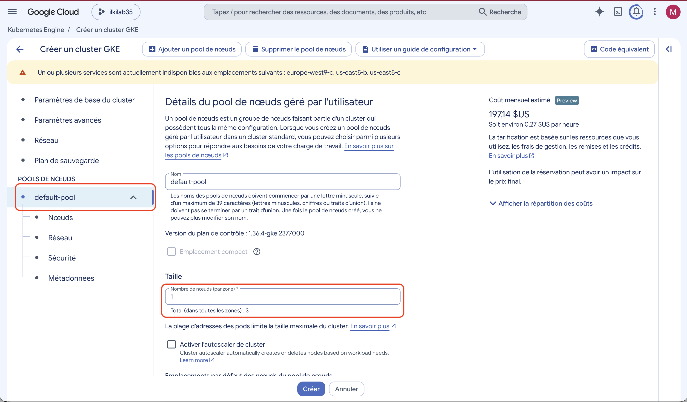
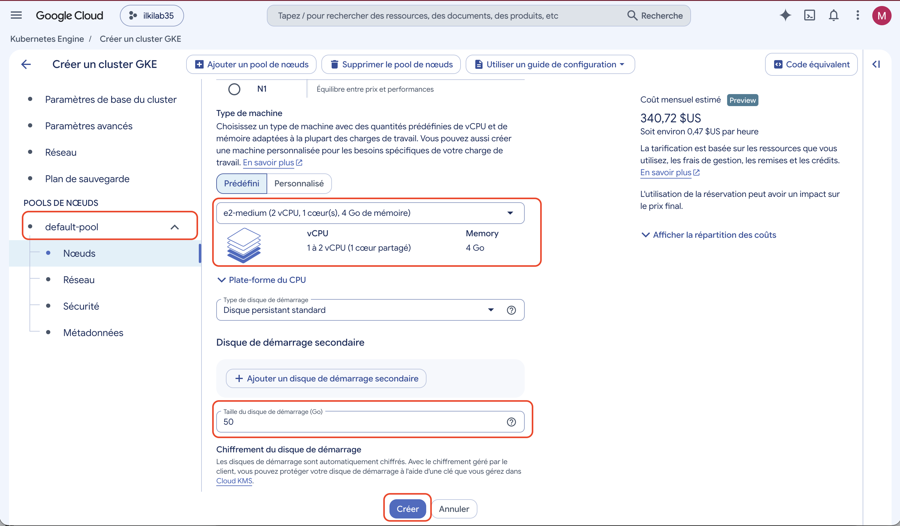

# LAB 00 - Créer son cluster Kubernetes sur GKE

> **Cluster : GKE** (créé dans ce lab) | **Durée : ~40 min** (dont ~10 min d'attente de création)
> **Prérequis :** un accès au projet Google Cloud fourni par le formateur (console :
> <https://console.cloud.google.com>).

Cette formation porte sur **Kubernetes**, pas sur Google Cloud. Nous utilisons **Google Kubernetes
Engine (GKE)** pour une seule raison : obtenir en quelques minutes un cluster Kubernetes complet,
sans installer de machines. Tout ce que vous ferez ensuite avec `kubectl` fonctionnerait de la même
façon sur n'importe quel autre cluster Kubernetes (sur un autre cloud, ou installé chez vous).

Dans ce lab, vous créez votre cluster depuis la **console web**, puis vous y connectez `kubectl`
depuis **Cloud Shell**, un terminal dans le navigateur, avec un éditeur de code intégré.

## Objectifs

1. Comprendre ce que contient un cluster Kubernetes, et ce que GKE gère pour vous.
2. Créer un cluster GKE depuis la console web.
3. Ouvrir Cloud Shell et son éditeur intégré.
4. Connecter `kubectl` au cluster, sous le nom de contexte `cluster-lab-dkdc`.
5. Préparer un environnement de travail confortable pour les labs suivants.

**Documentation utile :** [Composants d'un cluster Kubernetes](https://kubernetes.io/docs/concepts/overview/components/) · [GKE - vue d'ensemble](https://cloud.google.com/kubernetes-engine/docs/concepts/kubernetes-engine-overview) · [Cloud Shell](https://cloud.google.com/shell/docs/using-cloud-shell) · [Éditeur de Cloud Shell](https://cloud.google.com/shell/docs/editor-overview)

---

## Partie 1 : Ce qu'il y a dans un cluster Kubernetes

Un cluster Kubernetes se compose de deux parties :

* le **plan de contrôle** (*control plane*) : l'**API Server** (la porte d'entrée de toutes les
  commandes), la base **etcd** (l'état du cluster), le **scheduler** (qui choisit le nœud de chaque
  Pod) et le **controller manager** (qui fait converger l'état réel vers l'état souhaité) ;
* les **nœuds** (*workers*) : les machines qui exécutent vos conteneurs, chacune avec un **kubelet**
  (l'agent Kubernetes du nœud) et un **runtime de conteneurs** (containerd).

```text
         vous (kubectl)
              │  HTTPS
              ▼
 ┌─────────── plan de contrôle ───────────┐
 │  API Server ── etcd                      │   ◀── géré par Google sur GKE
 │  scheduler    controller manager         │
 └──────────────────────────────────────────┘
              │
   ┌──────────┼──────────┐
   ▼          ▼          ▼
 nœud 1     nœud 2     nœud 3                   ◀── vos machines (un « node pool »)
 kubelet    kubelet    kubelet
 Pods...    Pods...    Pods...
```

**1.1 - Qui gère quoi ?**

Complétez le tableau : pour chaque tâche, qui s'en charge sur GKE, et qui s'en chargerait sur un
cluster installé à la main ?

| Tâche | GKE | Cluster installé à la main |
| --- | --- | --- |
| Installer et sécuriser l'API Server et etcd | ? | ? |
| Sauvegarder etcd | ? | ? |
| Mettre à jour Kubernetes | ? | ? |
| Choisir le nombre et la taille des nœuds | ? | ? |
| Déployer et exploiter les applications | ? | ? |

<details><summary>Correction</summary>

| Tâche | GKE | 🏠 Cluster installé à la main |
| --- | --- | --- |
| Installer et sécuriser l'API Server et etcd | **Google** | vous (`kubeadm init`, certificats...) |
| Sauvegarder etcd | **Google** | vous |
| Mettre à jour Kubernetes | **Google**, automatiquement | vous (`kubeadm upgrade`) |
| Choisir le nombre et la taille des nœuds | **vous**, à la création du cluster | vous (création des machines) |
| Déployer et exploiter les applications | **vous** | vous |

Sur GKE, le plan de contrôle tourne chez Google : vous ne verrez jamais ses machines, et ses
composants n'apparaissent pas parmi vos Pods (Lab 01). Vous utilisez seulement l'**API** qu'il
expose. C'est précisément cette API qui est au cœur de la formation.

</details>

---

## Partie 2 : Créer le cluster dans la console

**2.1 - Le formulaire de création**

Dans la console Google Cloud, vérifiez en haut de page que le **projet** sélectionné est celui de la
formation. Suivez ensuite les étapes ci-dessous ; laissez par défaut tout ce qui n'est pas
mentionné.

**Étape 1 - Ouvrir la liste des clusters.** Ouvrez le menu principal (☰), survolez
**Kubernetes Engine**, puis cliquez sur **Clusters**.



**Étape 2 - Lancer la création.** Sur la page *Clusters Kubernetes*, cliquez sur **Créer**.



**Étape 3 - Nom et mode du cluster.** Dans *Paramètres de base du cluster* :

* **Nom** : `formation-<votre-prénom>` (minuscules, chiffres et tirets, sans accent) ;
* **Mode par défaut** : choisissez **Pool de nœuds géré par l'utilisateur**, et non *Autopilot*.



**Étape 4 - Emplacement.** Toujours dans *Paramètres de base du cluster*, un peu plus bas :

* **Type d'emplacement** : **Régional** ;
* **Région** : celle indiquée par le formateur ;
* **Emplacements de nœuds par défaut** : **Par défaut** (GKE répartit les nœuds sur 3 zones de la
  région) ;
* **Canal de publication** : laissez la valeur proposée.



**Étape 5 - Taille du node pool.** Dans le menu de gauche, sous *POOLS DE NŒUDS*, cliquez sur
**default-pool** :

* **Nombre de nœuds (par zone)** : **1**. La console affiche *Total (dans toutes les zones) : 3* ;
* **Activer l'autoscaler de cluster** : laissez la case **décochée**.



**Étape 6 - Type de machine.** Sous *default-pool*, cliquez sur **Nœuds** :

* **Type de machine** : **e2-medium** (2 vCPU partagés, 4 Go de mémoire) ;
* **Taille du disque de démarrage** : **50** Go.



**Étape 7 - Autoscaling vertical des Pods.** Dans le menu de gauche, ouvrez **Paramètres avancés**
et cochez **Activer l'autoscaling vertical des pods** (section *Automatisation* ; il servira au
Lab 11).

**Étape 8 - Créer.** Observez au passage le **coût mensuel estimé** affiché à droite, puis cliquez
sur **Créer**. La création prend 5 à 10 minutes : pendant ce temps, passez à la Partie 3.

*(Les libellés de la console évoluent : si un écran diffère des captures, demandez au formateur.)*

<details><summary>Correction</summary>

Ce que signifient ces choix :

| Choix | Pourquoi |
| --- | --- |
| **Pool de nœuds géré par l'utilisateur** | vous voyez et choisissez vos nœuds (le mode historiquement appelé *Standard*) ; en Autopilot, Google les gère et facture les Pods |
| **Régional** | le plan de contrôle est répliqué dans 3 **zones** (3 centres de données distincts de la région), et les nœuds y sont répartis : le cluster survit à la perte d'une zone entière. C'est la configuration de production |
| **1 nœud par zone** | dans un cluster régional, le nombre de nœuds se règle **par zone** : 1 × 3 zones = 3 nœuds. Saisir 3 donnerait 9 nœuds |
| **Autoscaler de cluster désactivé** | le nombre de nœuds reste fixe : la formation consomme le moins de ressources possible (Lab 11) |
| **e2-medium** | une petite machine (2 vCPU partagés, 4 Go), suffisante pour les labs : vous devrez dimensionner vos Pods avec soin (Lab 10) |
| **Canal de publication** | Google met à jour Kubernetes automatiquement, avec des versions éprouvées |
| **Autoscaling vertical** | installe le *VerticalPodAutoscaler* (Lab 11) |

Le cluster obtenu est un cluster Kubernetes **standard et certifié conforme** : les objets que vous
allez créer (Pods, Deployments, Services...) sont exactement les mêmes que sur tout autre cluster.

💡 **Astuce** - le bouton **Code équivalent**, en haut du formulaire, affiche la commande `gcloud`
ou le code Terraform qui créerait le même cluster : c'est ainsi qu'on automatise cette étape en
entreprise.

🏠 **En local** - pour obtenir un cluster équivalent, il faudrait créer trois machines, installer un
runtime de conteneurs, `kubeadm`, `kubelet`, initialiser le plan de contrôle, joindre les nœuds et
installer un plugin réseau (CNI). Pour un poste de développement, des outils comme **kind** ou
**minikube** créent un petit cluster en une commande.

</details>

**2.2 - Suivre la création**

Dans la liste des clusters, suivez l'état de votre cluster. Une fois la coche verte affichée, ouvrez
sa page de détails : quelle **version** de Kubernetes tourne ? Dans l'onglet **Nœuds**, combien de
nœuds voyez-vous, et dans quel état ?

<details><summary>Correction</summary>

* La version s'affiche dans l'onglet **Détails** (par exemple `1.35.x-gke.y`) : une version de
  Kubernetes, suivie du numéro de construction propre à GKE.
* L'onglet **Nœuds** liste le node pool `default-pool` et ses **3 nœuds**, à l'état **Ready**, un
  par zone.

Un **node pool** est un groupe de nœuds identiques (même type de machine, même configuration). Un
cluster peut en avoir plusieurs (Lab 10).

</details>

---

## Partie 3 : Cloud Shell et son éditeur

**3.1 - Ouvrir Cloud Shell**

Cliquez sur l'icône **Activer Cloud Shell** (`>_`) en haut à droite de la console. Un terminal Linux
s'ouvre en bas de page. Vérifiez que `kubectl` et `helm` sont installés, et que le projet de la
formation est bien sélectionné.

<details><summary>Correction</summary>

```bash
kubectl version --client
helm version
gcloud config get-value project          # l'identifiant du projet de la formation
```

Cloud Shell est une petite machine virtuelle personnelle, gratuite, avec les outils déjà installés et
déjà authentifiée avec votre compte. Votre dossier personnel (`~`, 5 Go) est **conservé** d'une
session à l'autre : vos fichiers de lab y resteront pendant toute la formation.

Si la commande `gcloud config get-value project` n'affiche pas le bon projet :
`gcloud config set project <ID-DU-PROJET>`.

</details>

**3.2 - L'éditeur intégré**

Cliquez sur **Ouvrir l'éditeur** dans la barre de Cloud Shell. Créez le dossier `labs` dans votre
dossier personnel, puis, dans ce dossier, un fichier `test.yaml` contenant deux lignes
(`apiVersion: v1` et `kind: Namespace`). Affichez ensuite ce fichier depuis le **terminal** de
l'éditeur (menu **Terminal → Nouveau terminal**, ou le bouton **Ouvrir le terminal**).

<details><summary>Correction</summary>

L'éditeur de Cloud Shell est un environnement de développement de type VS Code dans le navigateur :
explorateur de fichiers à gauche, onglets d'édition, terminal intégré, coloration et validation YAML.

```bash
mkdir -p ~/labs
cat ~/labs/test.yaml
rm ~/labs/test.yaml
```

💡 **Bon réflexe** - travaillez toujours dans des fichiers YAML enregistrés sous `~/labs/...`
plutôt qu'en tapant de longues commandes : vous pourrez les relire, les corriger et les réappliquer.
Dans tous les labs, *« écrivez le fichier `xxx.yaml` »* signifie : créez-le dans l'éditeur.

🔎 **Attention** - l'indentation YAML se fait avec des **espaces**, jamais des tabulations.

</details>

---

## Partie 4 : Connecter kubectl au cluster

**4.1 - Récupérer les identifiants**

Sur la page de votre cluster, cliquez sur **Connexion** (*Connect*). La console affiche une commande
`gcloud container clusters get-credentials ...` : choisissez **Exécuter dans Cloud Shell**, puis
validez la commande dans le terminal. Que fait cette commande ? Quel est le **contexte** courant de
`kubectl` ?

<details><summary>Correction</summary>

```bash
gcloud container clusters get-credentials formation-<prénom> --region <région> --project <ID-DU-PROJET>
# Fetching cluster endpoint and auth data.
# kubeconfig entry generated for formation-<prénom>.

kubectl config current-context
# gke_<ID-DU-PROJET>_<région>_formation-<prénom>
```

La commande écrit dans le fichier `~/.kube/config` (le **kubeconfig**) les trois informations dont
`kubectl` a besoin : l'**adresse** de l'API Server, le **certificat** de l'autorité du cluster, et
la façon de prouver votre **identité**. Ces trois informations forment un **contexte** (Lab 01).

C'est la **seule** commande `gcloud` indispensable de la formation : tout le reste se fait avec
`kubectl`.

</details>

**4.2 - Un nom de contexte lisible**

Le nom généré est long. Renommez le contexte courant en `cluster-lab-dkdc`, puis vérifiez la liste
des contextes. Interrogez enfin le cluster : adresse de l'API Server, liste des nœuds.

<details><summary>Correction</summary>

```bash
kubectl config rename-context "$(kubectl config current-context)" cluster-lab-dkdc
kubectl config get-contexts          # * cluster-lab-dkdc
kubectl cluster-info                 # Kubernetes control plane is running at https://34.x.x.x
kubectl get nodes -o wide
```

```text
NAME                                         STATUS   ROLES    VERSION         INTERNAL-IP   OS-IMAGE
gke-formation-alice-default-pool-1a2b-xk9p   Ready    <none>   v1.35.x-gke.y   10.132.0.5    Container-Optimized OS from Google
...
```

Les 3 nœuds sont `Ready`. Leur colonne `ROLES` est vide : ce sont des nœuds de travail, et aucun
nœud du **plan de contrôle** n'apparaît, puisqu'il est géré par Google.

🏠 **En local** - un cluster installé avec kubeadm afficherait aussi un nœud `control-plane`.

</details>

**4.3 - Les labels des nœuds**

Affichez les **labels** d'un nœud (`kubectl get node <nom> --show-labels`, ou `kubectl describe node`).
Retrouvez son **type de machine**, sa **zone** et son **node pool**. Affichez ensuite ces trois
informations pour tous les nœuds, sous forme de colonnes (`-L`).

<details><summary>Correction</summary>

```bash
kubectl get nodes -L node.kubernetes.io/instance-type,topology.kubernetes.io/zone,cloud.google.com/gke-nodepool
```

```text
NAME                    STATUS  ...  INSTANCE-TYPE   ZONE             GKE-NODEPOOL
gke-formation-...-xk9p  Ready        e2-medium       europe-west1-b   default-pool
gke-formation-...-7f2m  Ready        e2-medium       europe-west1-c   default-pool
gke-formation-...-q8rd  Ready        e2-medium       europe-west1-d   default-pool
```

Un nœud par **zone** : c'est le cluster régional.

Les labels `node.kubernetes.io/instance-type` et `topology.kubernetes.io/zone` sont **standard** :
on les retrouve sur tous les clouds. `cloud.google.com/gke-nodepool` est propre à GKE. Ces labels
serviront à placer des Pods (Lab 10).

</details>

**4.4 - La même chose dans la console**

Dans la console, ouvrez **Kubernetes Engine → Charges de travail**, puis cochez l'option qui affiche
les **objets système**. Retrouvez-vous des Pods ? Dans quel namespace ? Comparez avec
`kubectl get pods -A`.

<details><summary>Correction</summary>

```bash
kubectl get pods -A
```

Les deux vues montrent les mêmes Pods système de GKE, principalement dans le namespace
`kube-system` (DNS, métriques, agents de journalisation, pilote de disques...). Vous les étudierez au
Lab 01.

La console est une interface **en lecture** pratique ; dans cette formation, on travaille avec
`kubectl` et des fichiers YAML, qui fonctionnent sur tous les clusters.

</details>

---

## Partie 5 : Un environnement de travail confortable

**5.1 - Alias et complétion**

Ajoutez à votre `~/.bashrc` l'alias `k` pour `kubectl`, avec la complétion, et la variable `do`, qui
servira à générer des manifestes YAML sans rien créer (`--dry-run=client -o yaml`). Testez avec
`k get nodes` puis `k run test --image=public.ecr.aws/wizetraining/nginx:latest $do`.

<details><summary>Correction</summary>

```bash
cat >> ~/.bashrc <<'EOF'
source <(kubectl completion bash)
alias k=kubectl
complete -o default -F __start_kubectl k
export do="--dry-run=client -o yaml"
EOF
source ~/.bashrc

k get nodes
k run test --image=public.ecr.aws/wizetraining/nginx:latest $do     # affiche le YAML, ne crée rien
```

Générer un squelette YAML avec `$do` puis l'adapter est bien plus rapide et plus sûr que de
l'écrire de zéro. Vous l'utiliserez dans tous les labs.

</details>

**5.2 - Vos paramètres**

Quelques labs ont besoin du nom de votre cluster. Rangez-le, avec sa région, dans un fichier
`~/formation.env` chargé automatiquement à chaque ouverture de Cloud Shell.

<details><summary>Correction</summary>

```bash
cat > ~/formation.env <<'EOF'
export CLUSTER_NAME=formation-<prénom>      # à adapter
export REGION=europe-west1                  # à adapter
EOF
echo 'source ~/formation.env' >> ~/.bashrc
source ~/formation.env
echo $CLUSTER_NAME $REGION
```

</details>

---

## Partie 6 : En fin de formation

Un cluster GKE est facturé tant qu'il existe (ses nœuds, ses disques, ses équilibreurs de charge).
Le formateur vous indiquera s'il faut le supprimer vous-même à la fin de la formation.

**6.1 - Supprimer le cluster**

Où supprime-t-on le cluster dans la console ? Certains objets créés **par Kubernetes** dans Google
Cloud peuvent-ils survivre à cette suppression ? Comment le vérifier ?

<details><summary>Correction</summary>

Dans **Kubernetes Engine → Clusters**, menu **⋮** de votre cluster → **Supprimer**, puis confirmez en
saisissant son nom.

Les nœuds et leurs disques de démarrage disparaissent avec le cluster. En revanche, peuvent
subsister :

* les **disques persistants** de vos volumes (Lab 06), en particulier ceux dont la politique est
  `Retain` ;
* les **équilibreurs de charge** des Services `LoadBalancer` (Labs 04 et 08), si le cluster est
  supprimé avant eux.

D'où la règle : **supprimez vos objets Kubernetes d'abord** (`kubectl delete namespace ...`), puis le
cluster. Pour vérifier qu'il ne reste rien, la console (**Compute Engine → Disques**,
**Services réseau → Équilibrage de charge**) ou, en lecture, `gcloud` :

```bash
gcloud compute disks list --filter="name~pvc"
gcloud compute forwarding-rules list
```

</details>

---

## ✅ État attendu en fin de lab

* `kubectl config current-context` affiche `cluster-lab-dkdc` ;
* `kubectl get nodes` affiche **3 nœuds** `Ready` ;
* l'alias `k`, la variable `$do` et le fichier `~/formation.env` sont en place ;
* le dossier `~/labs` existe, et vous savez l'ouvrir dans l'éditeur de Cloud Shell.

---

## Points clés

* Un cluster = un **plan de contrôle** (API Server, etcd, scheduler, controller manager) + des
  **nœuds** (kubelet, runtime). Sur GKE, Google gère le plan de contrôle ; vous gérez les applications.
* Tout passe par l'**API** de Kubernetes : `kubectl`, la console, Helm, Argo CD en sont des clients.
* `gcloud container clusters get-credentials` écrit le **kubeconfig** ; `kubectl config
  rename-context` lui donne un nom lisible.
* Les labels standard des nœuds (`instance-type`, `zone`) existent sur tous les clouds.
* Supprimez vos objets Kubernetes **avant** le cluster, pour ne laisser aucun disque ni équilibreur
  facturé.
